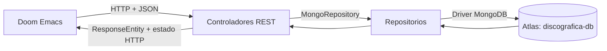
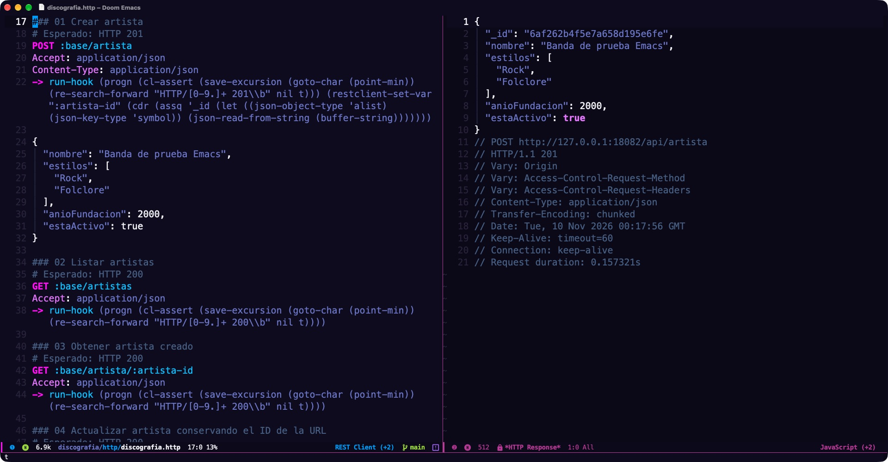
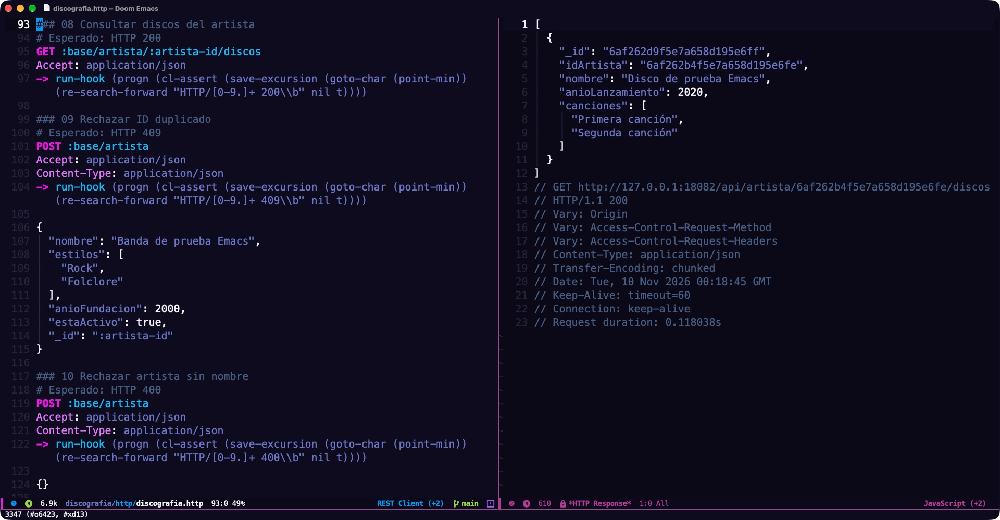
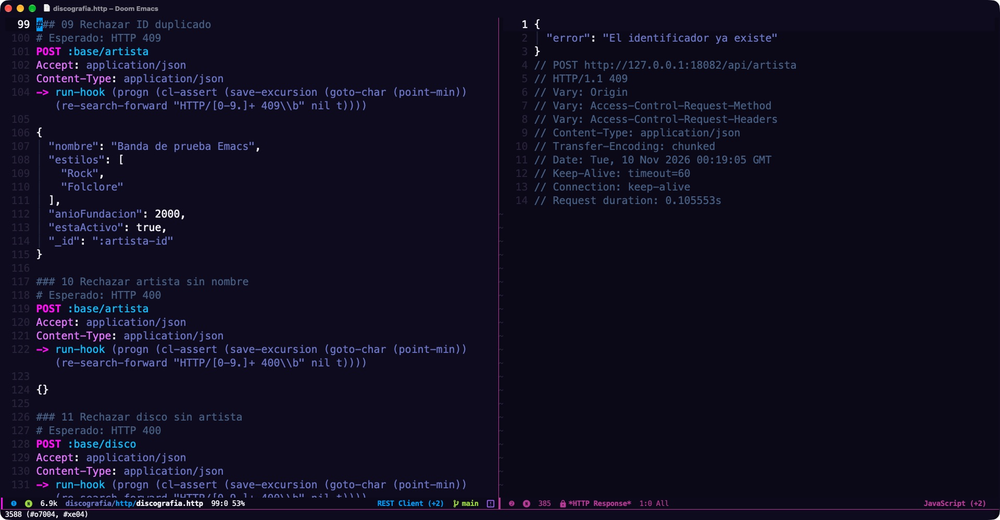

# Discografía API

Este proyecto salió del taller de la Unidad II de Programación de Servicios Web. Es una API REST para guardar artistas y discos, consultar discografías y actualizar o eliminar artistas. Para los ejemplos elegí algo de rock chileno: Los Jaivas, Los Prisioneros y Los Tres.

**Stack**

- Java 21
- Spring Boot 3.3.2
- Spring Web
- Spring Data MongoDB
- Gradle 8.8

La API corre localmente y guarda los datos en MongoDB Atlas. Uso **Doom Emacs** con `restclient-mode`, así que dejé las peticiones en archivos `.http` para ejecutarlas desde el editor. Hay 19 casos para recorrer la API y comprobar cómo responde.

- [Ejecutar el proyecto](#compilar-y-ejecutar)
- [Preparar Atlas](#preparar-mongodb-atlas)
- [Consultar rutas](#rutas)
- [Probar en Emacs](#probar-en-emacs)
- [Ver las respuestas](#recorrido-http-desde-emacs)

## Cómo funciona



Cada artista puede tener varios discos. `ArtistaController` trabaja con la colección `artistas` y `DiscoController` con `discos`. Antes de guardar un disco, compruebo que su artista exista. El vínculo queda en `Disco.idArtista`, que uso en la consulta `findDiscosByIdArtista` para recuperar su discografía.

```text
src/main/java/cl/iplacex/discografia/
├── DiscografiaApplication.java
├── ApiExceptionHandler.java
├── artistas/   # Modelo, repositorio y controlador
└── discos/     # Modelo, repositorio y controlador
src/main/resources/application.properties
http/          # Peticiones para Doom Emacs
docs/          # Capturas y respuestas reales
```

## Compilar y ejecutar

Uso JDK 21 y descargo las dependencias la primera vez que compilo. El proyecto incluye el wrapper de Gradle, así que no necesito instalarlo aparte. Con `JAVA_HOME` apuntando a JDK 21, ejecuto desde la carpeta del proyecto:

```sh
./gradlew test bootWar
```

Copio `.env.example` a `.env` y guardo la URI de mi conexión a Atlas en `MONGODB_URI`, sin comillas ni `export`:

```sh
cp .env.example .env
# Completo .env con mi URI antes de iniciar la aplicación.
java -jar build/libs/discografia-1.war
```

Spring carga automáticamente el `.env` de la carpeta desde la que ejecuto la aplicación. El archivo queda excluido de Git. También puedo definir `MONGODB_URI` como variable de entorno.

Por defecto, la API escucha en `http://localhost:8080`. Como necesita `MONGODB_URI` para arrancar, completo el `.env` antes de ejecutarla.

## Preparar MongoDB Atlas

1. Inicio sesión en Atlas y creo un clúster **Free/M0**, llamado `eva-u2-spring`.
2. Creo un usuario de base de datos y su contraseña. Le doy acceso de lectura y escritura a `discografica-db`.
3. En Network Access habilito mi IP pública actual.
4. En el explorador de datos preparo `discografica-db` con las colecciones `artistas` y `discos`. También pueden crearse con la primera inserción.
5. En Connect -> Drivers selecciono Java y copio la URI de Atlas. Sustituyo los marcadores por el usuario de base de datos y su contraseña, codifico los caracteres especiales para una URL y conservo el hostname que entrega Atlas.
6. Guardo esa URI en `MONGODB_URI` dentro de `.env` y ejecuto las pruebas HTTP.

La [guía de Atlas](https://www.mongodb.com/docs/atlas/tutorial/deploy-free-tier-cluster/) detalla cómo crear el clúster gratuito.

## Rutas

Todas comienzan con `/api`. Los cuerpos enviados y recibidos usan JSON.

| Verbo | Ruta | Operación | Respuesta correcta |
| --- | --- | --- | --- |
| POST | /artista | Insertar artista | 201, objeto creado |
| GET | /artistas | Listar artistas | 200, lista |
| GET | /artista/{id} | Obtener artista | 200, objeto |
| PUT | /artista/{id} | Reemplazar datos del artista | 200, objeto actualizado |
| DELETE | /artista/{id} | Eliminar artista | 200, confirmación JSON |
| POST | /disco | Insertar disco si existe su artista | 201, objeto creado |
| GET | /discos | Listar discos | 200, lista |
| GET | /disco/{id} | Obtener disco | 200, objeto |
| GET | /artista/{id}/discos | Filtrar discos por idArtista | 200, lista |

Los recursos individuales ausentes devuelven 404. Un filtro sin resultados devuelve `[]`. Un nombre vacío o un disco sin `idArtista` devuelve 400; un `_id` duplicado, 409; un fallo de acceso a datos, 500 sin detalles internos. JSON inválido produce 400 y un Content-Type no admitido, 415.

Parto con Los Jaivas. Para crear el artista, envío este JSON a `POST /api/artista`:

```json
{
  "nombre": "Los Jaivas",
  "estilos": ["Rock progresivo", "Folclore"],
  "anioFundacion": 1963,
  "estaActivo": true
}
```

La respuesta incluye un `_id`. Lo copio en `idArtista` y envío el siguiente JSON a `POST /api/disco` para agregar *Alturas de Machu Picchu*:

```json
{
  "idArtista": "ID_DEVUELTO_AL_CREAR_ARTISTA",
  "nombre": "Alturas de Machu Picchu",
  "anioLanzamiento": 1981,
  "canciones": ["La poderosa muerte", "Sube a nacer conmigo hermano"]
}
```

### Más ejemplos de rock chileno

Dejé más ejemplos en [http/rock-chileno.http](http/rock-chileno.http). El archivo crea los tres artistas, agrega estos discos y consulta sus discografías:

| Artista | Disco | Año | Algunas canciones incluidas |
| --- | --- | --- | --- |
| Los Jaivas | Alturas de Machu Picchu | 1981 | La poderosa muerte; Sube a nacer conmigo hermano |
| Los Prisioneros | La voz de los '80 | 1984 | La voz de los '80; Sexo; Paramar |
| Los Prisioneros | Pateando piedras | 1986 | El baile de los que sobran; Muevan las industrias; Quieren dinero |
| Los Tres | Los Tres | 1991 | Un amor violento; He barrido el sol; La primera vez |
| Los Tres | La espada y la pared | 1995 | Déjate caer; Tírate; La espada y la pared |

Abro el archivo, habilito `(setq-local restclient-enable-eval t)` con `M-:` y ejecuto las peticiones en orden con `C-c C-c`. Cada POST de artista guarda su ID para los discos siguientes. Antes de empezar reviso `:base`: estos ejemplos apuntan al puerto predeterminado **8080**.
Las canciones son una selección; cada POST inserta un nuevo registro y no hay borrado automático.

Referencias discográficas: [Los Prisioneros en Memoria Chilena](https://www.memoriachilena.gob.cl/602/w3-article-3574.html),
[Los Tres en Memoria Chilena](https://www.memoriachilena.gob.cl/602/w3-article-97568.html)
y [La espada & la pared](https://music.apple.com/us/album/la-espada-la-pared/682175019).

`PUT` reemplaza el objeto completo, así que envío todos los campos que quiero conservar.
El `_id` de la URL prevalece sobre el del cuerpo para evitar actualizar otro documento.

## Probar en Emacs

Para recorrer la API uso [http/discografia.http](http/discografia.http) con `restclient-mode`. Son **19 casos**: las nueve operaciones y las respuestas de error 400, 404 y 409. Los IDs se guardan entre peticiones, así que puedo seguir la secuencia desde el mismo buffer.

1. Mantengo la API iniciada. El archivo apunta a `http://127.0.0.1:18082/api`, el puerto que usé para probar con Atlas. Si arranco el WAR sin indicar un puerto, cambio `:base` a `http://127.0.0.1:8080/api`.
2. Abro `http/discografia.http` con `C-x C-f`. Doom activa `restclient-mode` por la extensión.
3. Activo las comprobaciones Lisp **solo en este buffer**: pulso `M-:` y evalúo:

   ```elisp
   (setq-local restclient-enable-eval t)
   ```

   Esto permite que los hooks comprueben los estados HTTP y guarden los IDs. El cambio
   se aplica solo a este buffer.
4. Pongo el cursor en la línea `POST` del caso **01** y pulso `C-c C-c` o `SPC m e`. Espero la respuesta antes de ejecutar el siguiente caso.
5. Sigo los casos en orden. El caso 01 guarda `:artista-id` y el 05 guarda `:disco-id` en memoria. Las siguientes peticiones los reutilizan automáticamente. Las comprobaciones fallidas muestran `cl-assertion-failed`; cada caso también indica el estado esperado en un comentario.

### Al ejecutar la secuencia

- El caso 04 envía un ID diferente en el cuerpo y comprueba que no reemplace al de la URL.
- El caso 15 comprueba que un filtro sin resultados devuelva `[]`.
- Los casos 16 a 19 eliminan el artista creado en 01 y comprueban los errores posteriores.
- Mantengo en `:artista-id` el ID generado por la prueba, para no eliminar un artista que quiera conservar.
- El disco de prueba se conserva porque no existe una ruta DELETE para discos.

Para empezar otra secuencia, vuelvo al caso 01 y sigo en orden: los nuevos POST reemplazan los IDs guardados. Los IDs viven en la sesión de Emacs.

Referencia: [restclient.el](https://github.com/pashky/restclient.el).

### Recorrido HTTP desde Emacs

Así se ven las peticiones y sus respuestas en Doom Emacs, con la API conectada a Atlas. Cada captura enlaza a su imagen a tamaño completo.

**Crear un artista · HTTP 201**

[](docs/capturas/emacs-crear-artista.png)

**Consultar la discografía · HTTP 200**

[](docs/capturas/emacs-consultar-discografia.png)

**Rechazar un ID duplicado · HTTP 409**

[](docs/capturas/emacs-id-duplicado.png)
